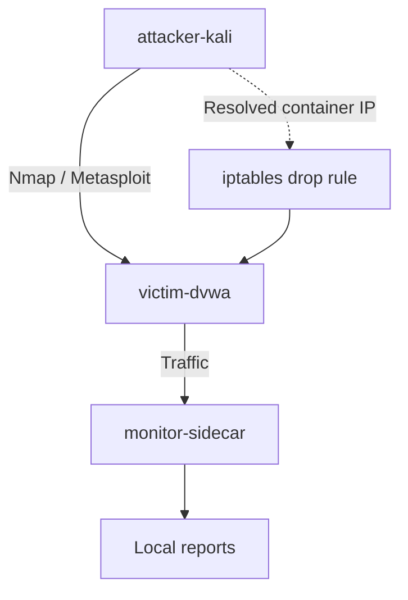

# Clash of Teams 101 — Breach and Defend Lab

Clash of Teams 101 is a containerized, educational cybersecurity lab for practicing a small red-team and blue-team workflow: reconnaissance, traffic capture, analysis, and firewall remediation.

## Current status

This is an experimental local lab, not a production security system. Run it only against the containers defined in this repository or another environment you own and are explicitly authorized to test. The generated reports are local artifacts and may describe historical runs; they are not proof that every pipeline stage succeeds on every host.

## What is included

- Nmap reconnaissance from a Kali-based attacker container.
- Optional Metasploit HTTP scanner automation.
- Tcpdump capture and traffic analysis from a monitor container.
- An iptables remediation script that resolves the attacker container's current IP before adding a drop rule.
- Docker Compose networking that keeps the lab services on an isolated bridge network.

## Requirements

- Docker Engine with Docker Compose.
- Linux, macOS, or WSL2 for the Bash scripts.
- At least 4 GB of available memory for the container images.
- Network access to pull the referenced images and install tools in the Kali container.

## Run the lab

Review the scripts before running them, then execute the pipeline from the repository root:

```bash
bash automation/run_full_pipeline.sh
```

For manual setup and individual checks, see [docs/setup.md](docs/setup.md). The pipeline installs Nmap and Metasploit inside the attacker container when they are missing, captures traffic, analyzes the capture, and attempts remediation. A failed tool installation or analysis step should be treated as a failed run rather than silently interpreted as a successful defense.

## Architecture



The scripts use Docker service names such as `victim` and `attacker-kali` instead of assuming fixed container IP addresses. Docker may assign different addresses each time the lab is recreated.

## Repository layout

```text
automation/       Attack, analysis, remediation, and orchestration scripts
defender/         Traffic capture and analysis helpers
docs/             Setup and project notes
infrastructure/   Docker Compose definition
reports/          Local generated logs and packet captures
```

## Limitations

- The lab has no automated test suite; validate each run from the generated logs and container state.
- Tool availability depends on the base images and package repositories at run time.
- The Docker images and included vulnerable application are intentionally unsafe outside the isolated lab network.

## License

This project is licensed under the [MIT License](LICENSE).

## Author

Yash Mahale

